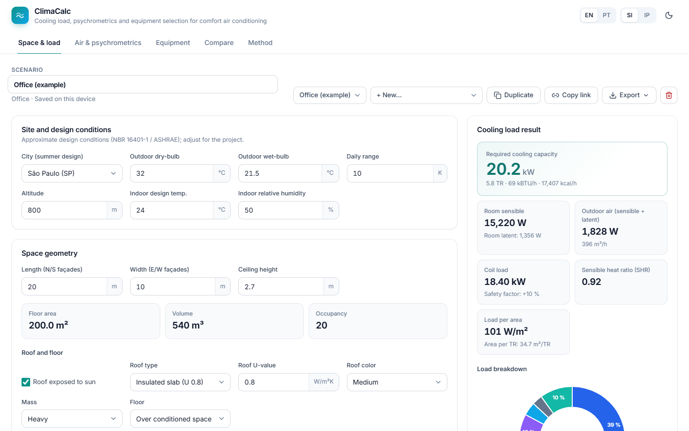
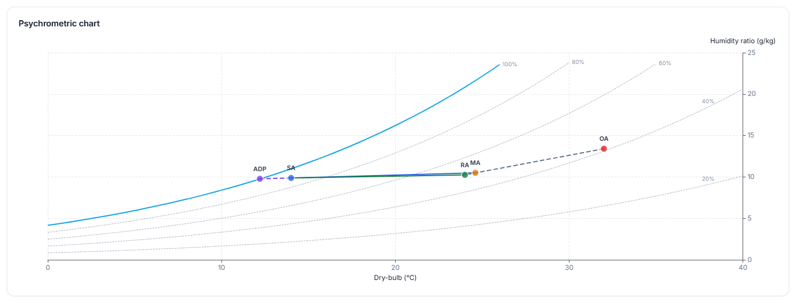

# ClimaCalc

Cooling load, psychrometrics and equipment selection for comfort air conditioning: offices, meeting rooms, classrooms, gyms, homes, shops, restaurants, hotel rooms, hospital rooms, auditoriums and server rooms.

It shares the thermodynamic engine of [FrigoCalc](https://frigocalc.frioeclima.workers.dev), which handles commercial and industrial refrigeration, and applies it to occupied spaces.

**Live:** https://climacalc.frioeclima.workers.dev





Everything runs in the browser. Nothing is sent to a server: scenarios stay in the device's local storage and can be exported as JSON or CSV, printed to PDF or shared as a link.

## What it calculates

| Tab | Contents |
| --- | --- |
| **Space & load** | Site and design conditions (15 Brazilian cities or your own), room geometry, walls and glazing by orientation (U value, mass, color, SHGC, shading), roof and floor, occupancy by activity, lighting, equipment, outdoor air (NBR 16401-3), infiltration, fan heat and safety factor. Results in kW, TR and BTU/h with the sensible and latent split, SHR, W/m², m²/TR, charts and an itemized table. |
| **Air & psychrometrics** | Supply airflow, air changes per hour, outdoor air fraction, supply air state, mixing, apparatus dew point (ADP) and bypass factor, and an interactive psychrometric chart with the OA, RA, MA, SA and ADP points. |
| **Equipment** | Split, VRF, rooftop, air-cooled or water-cooled chiller: standard sizes, N or N+1 units, nominal COP next to the real cycle COP (CoolProp), electrical demand (compressors, fans, pumps, cooling tower, kVA, current, transformer), chilled, condenser and make-up water, refrigerant charge, CO₂ equivalent, A2L/A3 room charge limit (IEC 60335-2-40), emergency ventilation and plant room areas. Also the p–h diagram and the load sensitivity to outdoor temperature and setpoint. |
| **Compare** | COP, GWP, power, discharge temperature and displacement of 23 fluids under the system's conditions, plus a side-by-side table of all saved scenarios. |
| **Method** | Assumptions, formulas, standards and limitations. |

SI or IP units, English or Portuguese, light or dark theme, print layout.

## Method in short

- Design-hour cooling load with the simplified CLTD/SCL/CLF method (ASHRAE Handbook Fundamentals), southern hemisphere tables. Outdoor air per NBR 16401-3, heat from people by activity (ASHRAE Fundamentals ch. 18).
- Hyland–Wexler psychrometrics with pressure corrected for altitude.
- Real properties for 23 fluids (CoolProp) in compact tables loaded on demand. Vapor-compression cycle with efficiencies estimated by compressor type.
- It is a pre-design tool. It does not replace detailed design (NBR 16401), hourly simulation or manufacturer selection software.

## Running locally

Needs Node 20.19 or newer.

```bash
npm ci
npm run dev        # http://localhost:5173
npm test
npm run lint
npm run build      # output in dist/
```

The property tables in `src/data/tables/` are already in the repo. To rebuild them you need Python 3 and CoolProp:

```bash
pip install -r tools/requirements.txt
python tools/gen_tables.py
```

## Project layout

| Path | What's there |
| --- | --- |
| `src/engine/` | Calculation engine: `hvac.ts` (load and air side), `equipment.ts`, `cycle.ts`, `psychro.ts`, `props.ts`, `presets.ts`, `refrigerants.ts` |
| `src/data/tables/` | One JSON table per fluid, generated with CoolProp |
| `src/components/` | Panels, charts and form controls |
| `src/state/` | Zustand store with persistence, Zod schemas for every input |
| `src/i18n/` | English and Portuguese strings |
| `tools/gen_tables.py` | Table generator |
| `public/_headers` | Security headers served by Cloudflare (CSP, HSTS and others) |

## Stack

React 19, TypeScript 5.9, Vite 7, ECharts 6, Zustand 5, Zod 4, lz-string, Vitest, ESLint 9. Hosted on Cloudflare Workers Static Assets.

## Security

No backend, no cookies, no tracking. Strict CSP with no third-party scripts, validation of everything that comes from outside (share links, imported files, local storage), and CI with lint, typecheck, tests, `npm audit`, CodeQL, gitleaks and Dependabot. Details in [SECURITY.md](SECURITY.md).

## Deploying

`npm run deploy` builds and uploads with wrangler. The GitHub Actions workflow does the same on every push to `main` once the `CLOUDFLARE_API_TOKEN` and `CLOUDFLARE_ACCOUNT_ID` secrets exist and the `CF_DEPLOY_ENABLED` variable is set to `true`.

## License

© 2026. All rights reserved by the author. See [LICENSE](LICENSE).
